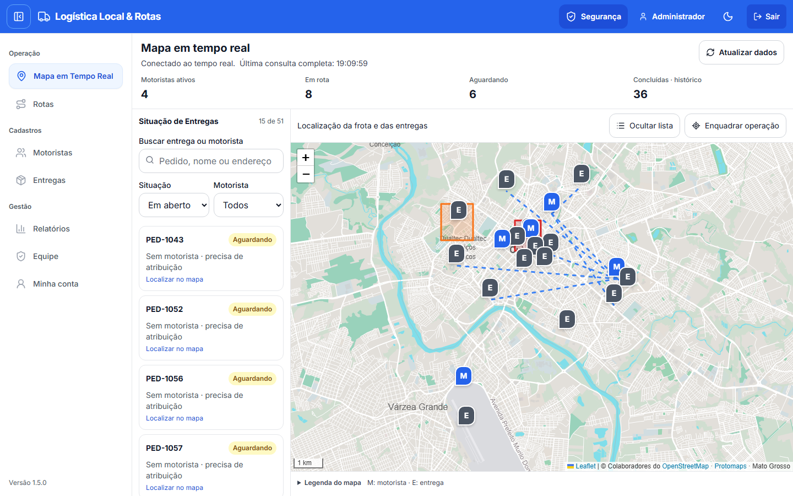
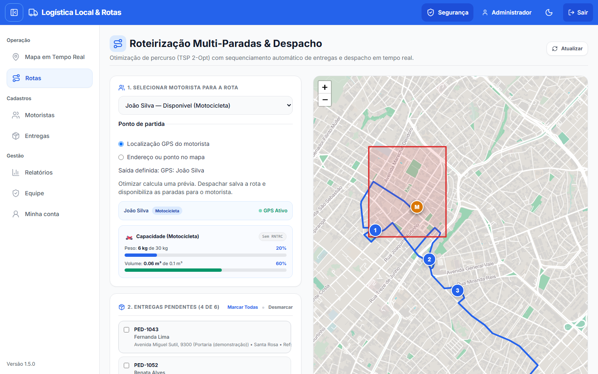
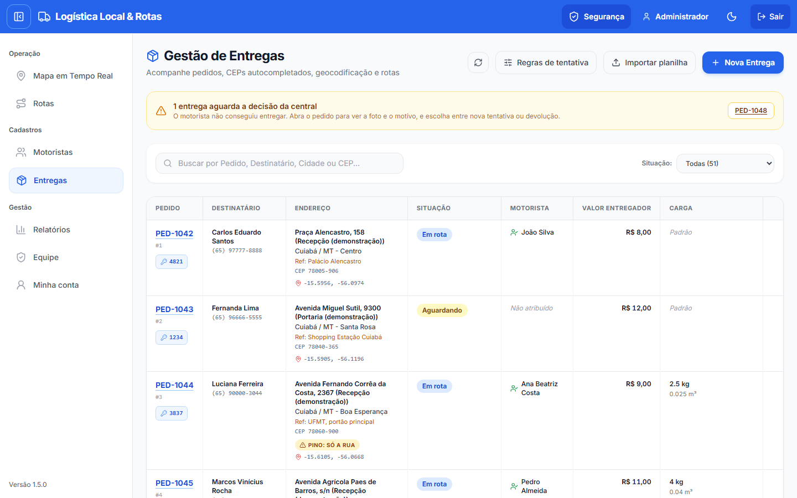
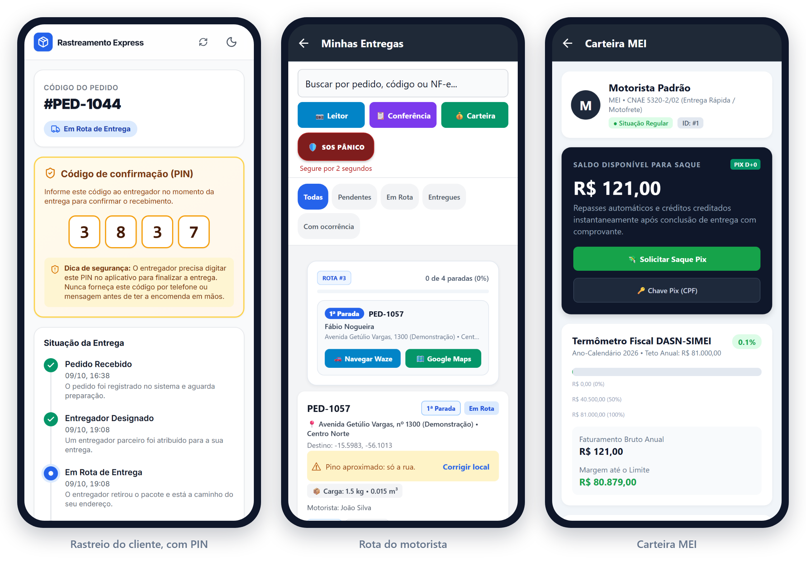
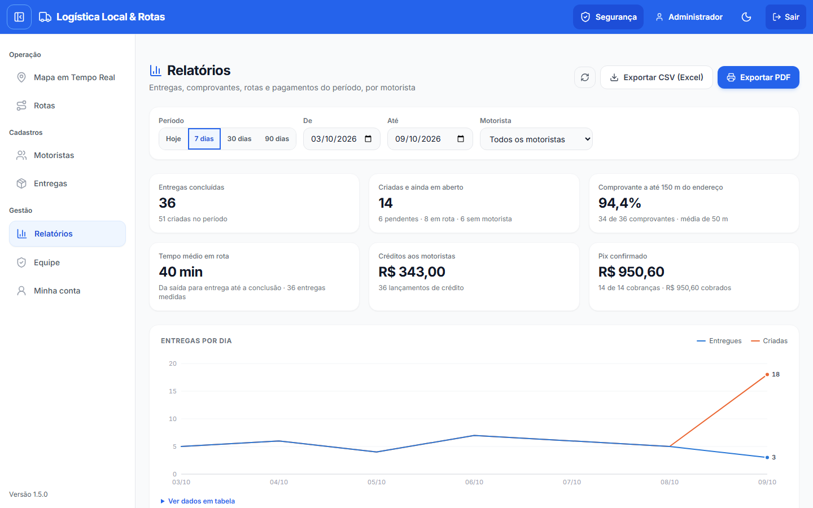

# Logística Local & Rotas — estudo de caso

**Português** · [English](README.en.md)

Sistema de entregas de última milha para transportadoras e lojas pequenas e médias de Mato Grosso. Junta numa mesma operação, em tempo real, quem despacha (painel da central), quem entrega (app do motorista) e quem recebe (link de rastreio).

- **Situação:** piloto em produção de 08/10/2026 a 15/10/2026; a versão final foi a 1.5.0. Foi substituído pelo [Tropeiro](https://sankler.com.br/#tropeiro), que recebeu os dados do piloto e continuou o trabalho.
- **Código:** privado. Este repositório mostra o produto, as decisões e o método.
- **Imagens:** sistema rodando localmente com dados fictícios em Cuiabá e Várzea Grande.

<picture>
  <source media="(prefers-color-scheme: dark)" srcset="assets/painel-escuro.png">
  
</picture>

## Por onde começou: as reclamações, não as funcionalidades

Antes de escrever código, levantei as dores de quem despacha, entrega e recebe no Brasil. As fontes foram Reclame Aqui, imprensa, avaliações de concorrentes estrangeiros (Onfleet, Routific, Circuit), legislação e entrevistas com usuários de ambos os lados, como os motoristas e os administradores. Foram 22 dores em três perfis de usuário, cada uma com fonte, prioridade e situação no código, atualizada a cada versão. Esse registro é o backlog do produto.

Algumas das dores que guiaram o projeto (os números são do mercado, não do produto):

- **Cliente:** "consta como entregue, mas não recebi" é uma das queixas mais repetidas no Reclame Aqui, e a apuração da loja com a transportadora pode levar até 10 dias.
- **Cliente:** "onde está meu pedido?". Segundo fornecedores de atendimento, de 30% a 50% dos chamados de lojas online são sobre o status do pedido.
- **Motorista:** ir até a porta, não conseguir entregar e não receber nada pela viagem.
- **Motorista:** sinal de internet ruim, endereço que o mapa não acha e insegurança na rua.
- **Operador:** escala montada à mão a partir de mensagens de WhatsApp e planilhas, e pedidos recadastrados porque já existem em outro sistema.

## O que o sistema faz com cada dor

| Dor | Resposta do sistema |
|---|---|
| "Entregue, mas não recebi" | PIN de 4 dígitos que só o cliente tem. Comprovante com foto, GPS, assinatura, cerca de 150 m em volta do endereço e hash de auditoria. O motorista nunca recebe o PIN pela API, e testes automatizados conferem isso. |
| "Onde está meu pedido?" | Link público de rastreio com mapa ao vivo, linha do tempo e dados pessoais mascarados (LGPD), pronto para enviar por WhatsApp. |
| Viagem perdida | Tentativa sem sucesso com motivo, ligações, foto e GPS. A central decide entre nova tentativa e devolução, e se paga a tentativa ao motorista. |
| Endereço que o mapa não acha | CEP com fonte alternativa e precisão do pino visível. O motorista sugere a posição da porta, o operador aprova, e o pino corrigido vale para as próximas entregas no mesmo endereço. |
| Sinal ruim | Fila offline: comprovantes e alertas são reenviados quando a conexão volta. |
| Despacho por WhatsApp e planilha | Roteirização com várias paradas e limite de carga do veículo, despacho em tempo real e importação de planilha CSV com prévia de erros por linha. |
| Insegurança | Botão de pânico silencioso com alerta em tempo real na central e zonas de risco no mapa. |
| Motorista MEI | Carteira com extrato, crédito ao concluir com comprovante e acompanhamento do teto anual do MEI. |
| Cobrança na entrega | Pix dinâmico no padrão do Banco Central (QR Code e copia e cola). |

## Telas

**Roteirização.** Ordem das paradas otimizada, traçado pelas ruas e termômetro de carga do veículo.

<picture>
  <source media="(prefers-color-scheme: dark)" srcset="assets/rotas-escuro.png">
  
</picture>

**Entregas.** Uma tentativa sem sucesso fica em destaque até a central decidir o que fazer.

<picture>
  <source media="(prefers-color-scheme: dark)" srcset="assets/entregas-escuro.png">
  
</picture>

**Celular.** Rastreio do cliente com PIN, rota do motorista com atalhos para Waze e Google Maps, e carteira MEI.

<picture>
  <source media="(prefers-color-scheme: dark)" srcset="assets/celulares-escuro.png">
  
</picture>

**Relatórios.** Entregas, comprovantes, tempo em rota, créditos e Pix por período e por motorista, com exportação em CSV e PDF.

<picture>
  <source media="(prefers-color-scheme: dark)" srcset="assets/relatorios-escuro.png">
  
</picture>

## Como foi construído

- **Arquitetura.** Monorepo com três aplicações:
  - API em Node.js, Express, Prisma e Socket.io;
  - painel em Next.js 15, Tailwind e Leaflet;
  - app do motorista em React Native com Expo, que também roda no navegador do celular.
- **Tempo real com permissão por perfil.**
  - A central recebe tudo, o motorista só as próprias entregas e a página pública só a própria entrega.
  - Os eventos levam apenas um aviso, e os dados são buscados na API, que aplica as permissões.
- **Mapas próprios.**
  - O mapa de todo Mato Grosso ficava hospedado no próprio servidor (PMTiles, dados do OpenStreetMap), sem depender de serviço de mapas de terceiros.
  - A ordem das paradas usa vizinho mais próximo com 2-Opt, e o traçado pelas ruas vem do OSRM.
- **Segurança.**
  - Cadastro de motorista só por convite de uso único.
  - Trocar e-mail ou senha encerra as sessões antigas.
  - Verificação em duas etapas por e-mail é opcional e tem códigos de recuperação.
  - Testes com clientes Socket.io reais conferem quem recebe cada evento.
- **Qualidade.**
  - 169 testes de regressão da API e testes de ponta a ponta com Playwright.
  - Cada versão é conferida em Chromium e WebKit, em tela de computador e de celular, nos temas claro e escuro.
- **Implantação.**
  - Versões publicadas como pacote com checksum SHA-256.
  - Cada migração é ensaiada numa cópia do banco, com backup antes de aplicar.
  - Depois de publicar, só há verificações de leitura em produção.
  - Na VM micro, a API usava cerca de 71 MiB de memória e o painel cerca de 95 MiB.

## Próximos passos

Com a troca, estes passos ficaram para o Tropeiro:

- Separar os dados por empresa cliente, para oferecer o sistema como assinatura.
- Avisos automáticos ao cliente ("saiu para entrega", "não conseguimos entregar").
- Confirmação automática de pagamento integrada a um provedor de Pix.

## Contato

Desenvolvido por **Sankler Bergman**. O código é privado; mostro funcionando o [Tropeiro](https://sankler.com.br/#tropeiro), que continuou este piloto.

[contato@sankler.com.br](mailto:contato@sankler.com.br) · [LinkedIn](https://www.linkedin.com/in/sankler-bergman-64962511b/) · [Outros projetos](https://github.com/sanklerbergman)
